# Codara

**Semantic code search and read-only codebase retrieval for coding agents, over MCP.**

[](https://github.com/sitien173/codara/actions/workflows/ci.yml)

[](LICENSE)

[Overview](#overview) | [Architecture](#architecture) | [Install](#install) | [MCP tools](#mcp-tools) | [CLI](#cli) | [Configuration](#configuration) | [Development](#development)

## Overview

Codara is a stdio MCP server that gives Claude Code, Codex, Antigravity (`agy`), and Pi three capabilities they lack out of the box:

- **Semantic search.** Find code by meaning. Codara embeds your repository with Voyage AI and ranks chunks by cosine similarity.
- **Incremental indexing.** One SQLite file per repository. Unchanged files are skipped and identical chunks reuse their stored embeddings.
- **Read-only retrieval.** Ask a question and a separate agent CLI investigates the repository, under read-only flags and a git change guard.

Exact-match search stays with the client agent's built-in grep.

## Architecture

[](docs/diagrams/architecture.html)

The MCP client talks to `codara-mcp` over stdio. Only the `codara index` subprocess writes the index at `<repo>/.codara/index-v2.sqlite`; every other tool reads it. `codebase_retrieval` delegates to an agent CLI through `coding-agent-cli`. Open [docs/diagrams/architecture.html](docs/diagrams/architecture.html) for the full-size view.

### Data flow

[](docs/diagrams/data-flow.html)

Indexing walks the repository, chunks changed files into 30-line windows with 15 lines of overlap, embeds only new chunks, and upserts them into SQLite. Search embeds the query, scores it against the cached matrix, and flags hits whose files changed since indexing. Open [docs/diagrams/data-flow.html](docs/diagrams/data-flow.html) for the full-size view.

## Install

Requires Python 3.12+, [`uv`](https://docs.astral.sh/uv/), and a `VOYAGE_API_KEY` for indexing and search.

Install Codara as a plugin for your agent:

| Agent | Commands |
|---|---|
| Claude Code | `claude plugin marketplace add sitien173/codara`<br>`claude plugin install codara-mcp@codara-mcp` |
| Codex | `codex plugin marketplace add https://github.com/sitien173/codara.git`<br>`codex plugin add codara-mcp@codara-mcp` |
| Pi | `pi install https://github.com/sitien173/codara` |
| Antigravity | Clone the repository, then `agy plugin install <clone>/plugin` |

Each plugin starts the server with `uvx --from git+https://github.com/sitien173/codara codara-mcp`.

To run from a local checkout instead:

```bash
git clone https://github.com/sitien173/codara.git
cd codara
uv sync
uv run codara-mcp
```

`python -m codara_mcp` starts the same server.

> [!TIP]
> Build the index once before searching: `uv run codara index <repository>`, or call the `index_update` tool from your agent.

## MCP tools

| Tool | Parameters | Result |
|---|---|---|
| `semantic_search` | `repository_path`, `query`, `path="."`, `top_k=10` (1-50), `context_lines=0` (0-20) | `hits`: `{path, start_line, end_line, score, stale, text}`; `index`: `{generation, last_indexed}`; truncation metadata |
| `index_status` | `repository_path` | `{exists, model_key, files, chunks, embeddings, stale, next_step}` |
| `index_update` | `repository_path`, `rebuild=false` | `{files_scanned, files_changed, files_deleted, chunks_embedded, chunks_reused, duration_ms}` |
| `codebase_retrieval` | `repository_path`, `query` | `{answer, driver, duration_ms, repo_modified, git_check}` plus truncation metadata |

`semantic_search` reads the index only and returns no hits for a path outside the repository. `index_status` compares file metadata and does not hash files. Only `index_update` writes the index.

Tool errors use these codes: `INVALID_PATH`, `INVALID_ARGUMENT`, `INDEX_MISSING`, `INDEX_MODEL_MISMATCH`, `INDEX_BUSY`, `MISSING_API_KEY`, `EMBED_FAILED`, `TIMEOUT`, `RETRIEVAL_BUSY`, `REPO_MODIFIED`, `BINARY_NOT_FOUND`, and `INTERNAL_ERROR`.

### Retrieval safety

`codebase_retrieval` runs the configured agent CLI with driver-specific read-only flags, then compares git status and file hashes before and after the run. Any change returns `REPO_MODIFIED`. At most two retrievals run at once by default, and a retrieval started inside another retrieval is refused.

> [!WARNING]
> The git check is a guard, not an operating-system sandbox. It does not cover ignored files or paths outside the repository. The `agy` CLI has no flag to disable MCP servers, so that driver can still reach them.

## CLI

```bash
uv run codara index <repository> [--rebuild] [--json]   # create or refresh the index
uv run codara status <repository>                       # report index state
uv run codara stats                                     # summarize local telemetry
```

## Configuration

Settings load from non-empty environment variables first, then `~/.codara/config.toml`, then defaults. Removed keys log one warning at startup and are ignored. Unknown keys and invalid values stop startup.

| TOML section | Key | Environment variable | Default |
|---|---|---|---|
| `[embedding]` | `model` | `CODARA_MODEL` | `voyage-code-3` |
| `[embedding]` | `dimensions` | `CODARA_DIMENSIONS` | `1024` |
| `[embedding]` | `batch_size` | `CODARA_BATCH_SIZE` | `128` |
| `[voyage]` | `timeout_s` | `CODARA_VOYAGE_TIMEOUT` | `120.0` |
| `[voyage]` | `retries` | `CODARA_VOYAGE_RETRIES` | `5` |
| `[chunking]` | `lines` | `CODARA_CHUNK_LINES` | `30` |
| `[chunking]` | `overlap_lines` | `CODARA_OVERLAP_LINES` | `15` |
| `[index]` | `timeout_s` | `CODARA_INDEX_TIMEOUT_S` | `1800.0` |
| `[telemetry]` | `enabled` | `CODARA_TELEMETRY` | `true` |
| `[telemetry]` | `dir` | `CODARA_TELEMETRY_DIR` | `~/.local/state/codara-mcp/telemetry` or `$XDG_STATE_HOME/codara-mcp/telemetry` |
| `[telemetry]` | `retention_days` | `CODARA_TELEMETRY_RETENTION_DAYS` | `30` |
| `[retrieval]` | `max_concurrent` | `CODARA_RETRIEVAL_MAX_CONCURRENT` | `2` |
| `[agent]` | `driver` | `CODARA_AGENT_DRIVER` | required for retrieval |
| `[agent]` | `model` | `CODARA_AGENT_MODEL` | driver default |
| `[agent]` | `reasoning` | `CODARA_AGENT_REASONING` | driver default |
| `[agent]` | `args` | `CODARA_AGENT_ARGS` | `[]` |
| `[agent]` | `executable` | `CODARA_AGENT_EXECUTABLE` | driver executable |
| `[agent]` | `timeout_s` | `CODARA_AGENT_TIMEOUT_S` | `1800.0` |

Example `~/.codara/config.toml`:

```toml
[embedding]
model = "voyage-code-3"
dimensions = 1024

[telemetry]
enabled = false

[agent]
driver = "claude"
timeout_s = 900
```

Agent drivers are `pi`, `claude`, `codex`, and `agy`. `driver` has no default.

### Ignoring files

The indexer follows `git ls-files` in a git work tree and `.gitignore` elsewhere. Add a `.codaraignore` file with gitignore syntax to exclude more paths. `.git`, `.codara`, binary files, and files over 1 MiB are always skipped.

### Telemetry

Telemetry stays on your machine. Each tool call appends a JSONL event, including the query, search path, and repository path, under `~/.local/state/codara-mcp/telemetry` or `$XDG_STATE_HOME/codara-mcp/telemetry`. Events are kept for 30 days. Disable telemetry with `CODARA_TELEMETRY=0` or `[telemetry] enabled = false`.

> [!NOTE]
> **Upgrading from Auggie.** The project was renamed from `auggie-mcp` with no fallback. Rename `.auggie/` to `.codara/`, `.auggieignore` to `.codaraignore`, `~/.auggie/config.toml` to `~/.codara/config.toml`, and `AUGGIE_*` variables to `CODARA_*`, or rebuild the index with `codara index --rebuild`.

## Development

```bash
uv sync
uv run --frozen pytest tests -q
uv run --frozen ruff check src tests scripts
uv run --frozen ty check src
uv run --frozen python scripts/check_versions.py
```

Contributor and agent conventions live in [AGENTS.md](AGENTS.md). Release notes live in [CHANGELOG.md](CHANGELOG.md).
